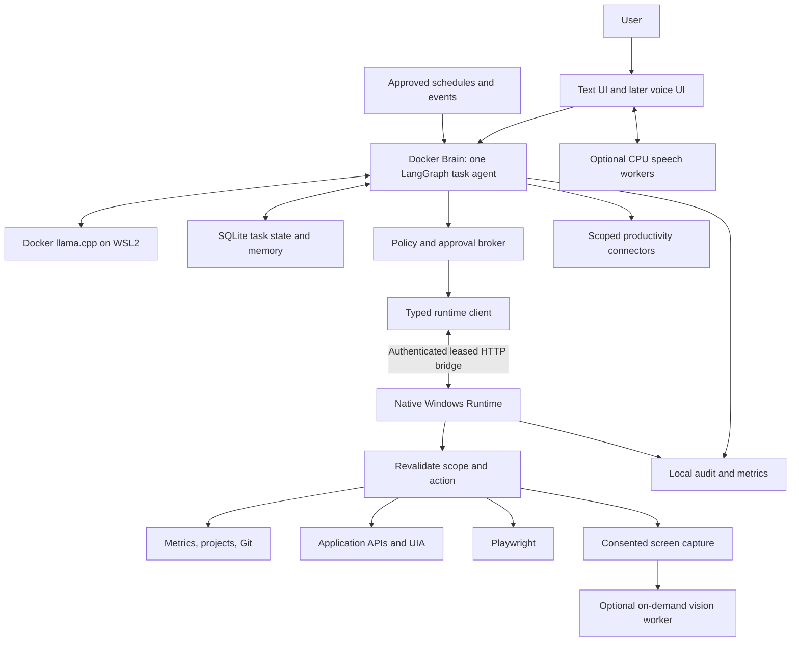
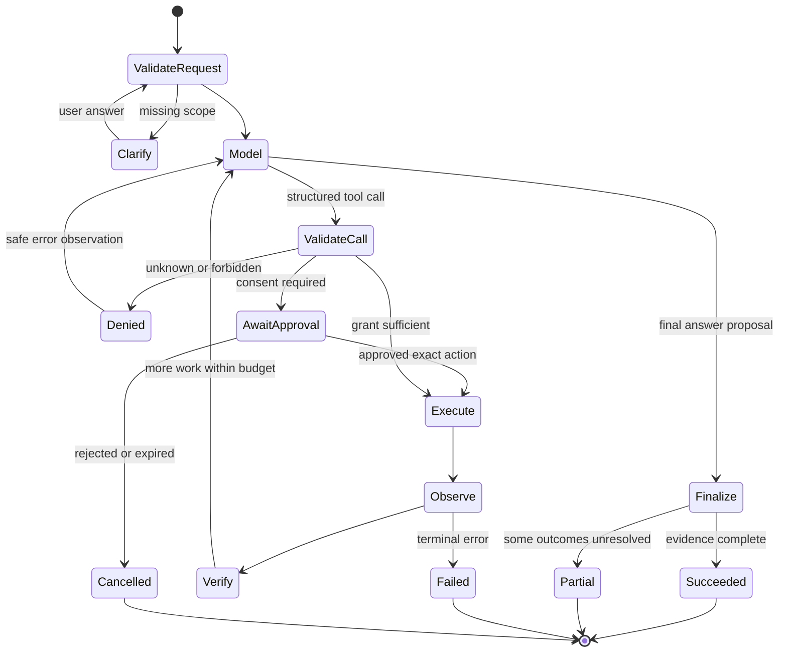
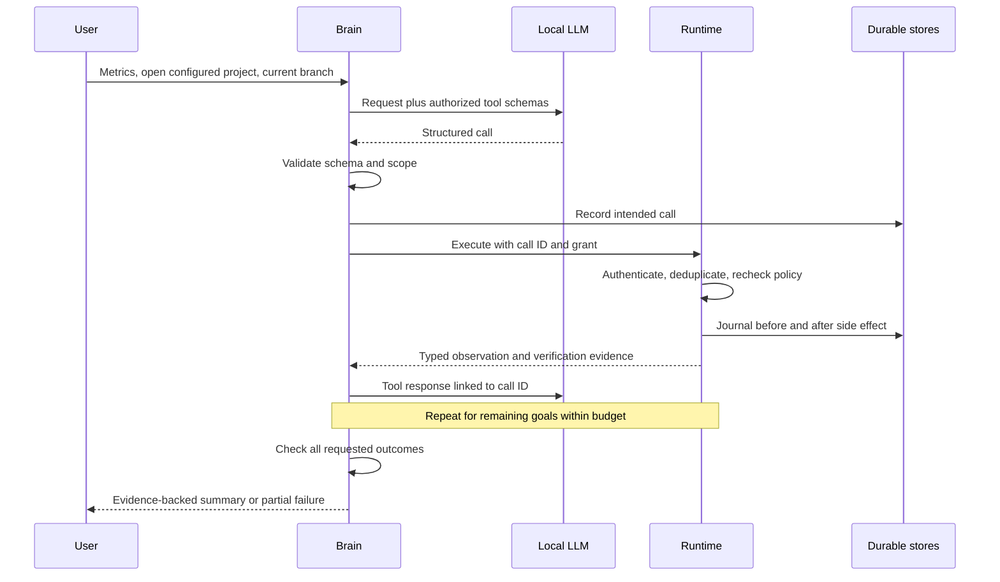

# JARVIS Full Hybrid Implementation Plan

Planning date: 2026-10-12 (Asia/Saigon). Updated: 2026-10-13. Status: Phases 0 and 1 implemented and validated; Phase 2 has not started. See docs/architecture/decisions.md and docs/benchmarks/baseline.md for evidence and remaining gates.

This is the standalone JARVIS project at `D:\Coder-IT\AI\jarvis-ai`. The initial planning request authorized this document only. On 2026-10-13 the user authorized updating it and executing Phase 0. Research scripts, configuration examples and Phase 0 evidence are now authorized; On 2026-10-13 the user subsequently authorized Phase 1 implementation; Phase 2 and later phases remain future work. No reference files are to be changed. Suggested performance thresholds remain engineering targets; measured Phase 0 results are explicitly linked.

## 1. Executive Summary

Build a local-first desktop assistant around one task-oriented LangGraph agent, a separate capability-limited Windows Desktop Runtime, and one local llama.cpp inference server. Run Brain and llama.cpp in separate Linux Docker containers on WSL2. Keep the capability-limited Desktop Runtime native in the active Windows user session. Install backend libraries during image builds without a host venv; keep SQLite and model artifacts in JARVIS-owned Linux volumes. Prefer the existing native Ubuntu Docker Engine on this machine; Docker Desktop WSL2 is an alternative, not a second required engine.

The first release accepts text, retrieves system metrics, opens a configured project in VS Code, reads its Git branch, verifies those results, and reports partial failures accurately. It uses genuine structured model tool calls. It has no general shell tool, cloud inference dependency, VLM, avatar, or multi-agent framework.

The complete end-state adds developer workflows, interruptible local speech, application and browser automation, on-demand screen understanding, productivity APIs, controlled proactive rules, and editable personal memory. These share the same authorization, task state, verification, and audit infrastructure.

The reference repository is useful but cannot be transplanted wholesale. Its `dev` graph is a roleplay pipeline, not a model-directed action loop; STT on that revision is a disabled stub; its allowlist has an unknown-agent permissive path. Selected audio helpers can be reused; registries, transport, speech adapters, and retrieval concepts require adaptation. Desktop authority and task orchestration require redesign.

## 2. Product Vision and Design Goals

JARVIS should feel responsive, articulate, and aware of task progress while being honest about what it observed and completed. An attractive voice or avatar must never substitute for verified work.

| Goal | Design consequence | Trade-off |
|---|---|---|
| Local-first privacy | Local inference, local task database, external APIs enabled individually | Smaller local models may need clarification more often |
| Useful agency | Model chooses typed tools and revises actions using observations | More latency than fixed command dispatch |
| Windows reliability | Native runtime in the signed-in user session; APIs before GUI | Platform-specific integration and manual desktop tests |
| Resource efficiency | One loaded heavy model; lazy optional workers | Cold-start delays when capabilities activate |
| User control | Visible task state, stop control, scoped grants, exact-action approvals | Sensitive operations sometimes pause |
| Independent project | Copy or reimplement reviewed components with attribution | Some duplicated maintenance; no runtime dependency on Persona Graph AI |
| Measurable quality | Evaluate task completion and false-success rate | Benchmark maintenance is recurring work |

Priority ladder: immediate MVP (Phases 0–4 plus the narrow Git branch reader brought forward into Phase 2); intermediate developer/voice releases (5–6); advanced vision/productivity/proactivity (7–9); portfolio and optimization (10). Basic personalization starts with MVP configuration; semantic memory and avatars are optional extensions.

## 3. Hardware Constraints

### Confirmed local inspection

Read-only inspection used PowerShell CIM, `nvidia-smi`, `wsl --list --verbose`, Git object reads, and file reads. No application code was executed. No dependencies, models, or containers were installed or started.

| Item | Observed fact |
|---|---|
| Laptop | ASUS TUF Dash F15 FX517ZC_FX517ZC |
| CPU | Intel Core i5-12450H, 12th generation |
| Physical memory reported by Windows | 25,372,315,648 bytes, approximately 23.63 GiB |
| GPU | NVIDIA GeForce RTX 3050 Laptop GPU; 4096 MiB VRAM |
| NVIDIA driver | 616.92 |
| OS | Windows 11 Home Single Language, version 10.0.26200 |
| WSL | Ubuntu running in WSL2; docker-desktop distribution stopped at inspection |
| Tools | Python 3.10.11, Git 2.52.0.windows.1; Docker and WSL executables available |
| Workspace | Initially empty in directory listing; no JARVIS application inspected |
| D: free space | Approximately 19.9 GiB at inspection; changes over time |

Initial planning-time Docker executable availability did not establish daemon readiness. Phase 0 subsequently validated the native Ubuntu Docker Engine, CPU/GPU inference and Windows localhost forwarding; see the baseline. Driver visibility does not establish llama.cpp CUDA compatibility. At initial planning these items were unverified. Phase 0 confirmed the primary GGUF/checksum, container CUDA inference, VS Code path, jarvis-ai project alias and English scope. Microphone devices, CUDA toolkit installation, thermal/power settings, WSL memory limits and provider accounts remain unverified. No measurements were made during initial planning; Phase 0 smoke latency measurements are now recorded separately. Do not infer available RAM or VRAM from capacity alone.

Budget for Windows, browser, editor, and display VRAM before inference. Start with a 1.5B–3B Q4 model, 2,048 or 4,096 context tokens, one request slot, and measured GPU layer offload. Evaluate 4B only if the combined weights, KV cache, compute buffers, and display use fit with headroom. Avoid model/container caches competing for the remaining disk space.

## 4. Persona Graph AI Reuse Assessment

### Evidence and revision boundaries

Reference: [truongNgn/persona-graph-ai](https://github.com/truongNgn/persona-graph-ai). Existing local checkout: `D:\Coder-IT\AI\persona-graph-ai`.

- Required local `dev` snapshot: `6f86e7f95eed6dec317b0a7548aedbca1e804018` (label **D** below).
- Current checked-out branch: `feature/hands-free-voice`, HEAD `25281d4a0d8216d974365dd086f6423e1cc302d1` (label **F**). `git status --short` was empty.
- `dev` was read with `git show dev:<path>` without checkout, fetch, clone, or modification. Its freshness relative to GitHub is unknown.
- Feature revision differences were inspected selectively, not audited exhaustively. No reference tests were run. “Present” is source evidence, not proof of runtime correctness.
- No root license appeared in the inspected `dev` root tree; confirm reuse rights and third-party/model/voice/asset licenses before copying. This is an unresolved release dependency.
- Reference `AGENTS.md` was read. Its project-log update instructions do not authorize changes to that repository; the user's single-file planning restriction takes precedence.

All paths in this table are relative to that reference repository. Complexity describes extraction/migration, not historical code quality.

| Component / evidence | Class | Dependencies / complexity | Recommendation and technical reason |
|---|---|---|---|
| D `backend/app/tts_handler.py`: `pcm_to_wav`, `is_wav`, `is_mp3` | REUSE | Python `io`, `wave`; low | Extract only pure format helpers with provenance and tests; require explicit sample format. Do not inherit permissive `ensure_wav` assumptions for arbitrary input. |
| D `backend/app/tools/base.py`, `tools/registry.py` | ADAPT | Pydantic, AgentContext, guardrails, feedback store; medium | Preserve typed result/error and timing pattern; replace loose argument dictionaries, character context, global store, duplicate-name overwrite, and direct dispatch with per-tool schemas and default-deny execution. |
| D `backend/app/agents/registry.py` | EXCLUDE | BaseAgent/character-oriented context; low | Registry selects a default roleplay agent. A single compiled graph is sufficient; no agent router needed. |
| D `backend/app/lc_graph.py` | REDESIGN | LangGraph, persona, chain, histories; high | Fixed retrieval → prompt → generation → memory graph, compiled without persistent checkpointer. No repeated model-selected actions or completion verifier. Its `asyncio.Queue` must not enter persisted task state. |
| D `backend/app/lc_chain.py`, `llm_handler.py` | ADAPT | LangChain provider adapters, Ollama/cloud SDKs; medium | Reuse provider boundary concept; `StrOutputParser` and text-only streams lose structured tool-call information. Remove emotion-tag system prompt and implicit provider fallback. |
| F `backend/app/model_registry.py`, `lc_chain.py` | ADAPT | YAML, settings, provider clients; medium | Catalog metadata and OpenAI-compatible local endpoint are useful. Catalog is absent on D. Reduce to one explicit model profile plus tested local fallback; avoid importing discovery/cloud dependencies. |
| D `backend/app/gateway/websocket.py` | ADAPT | FastAPI, auth, warmup, orchestrator; medium | Cancellation and sink separation are useful patterns. Replace roleplay messages with versioned task events, scoped authentication, bounded queues, and reconnect cursors. |
| D `backend/app/stt_handler.py` | REDESIGN | Abstract handler + settings; medium | Factory always returns DisabledSTTHandler; listing faster-whisper in requirements does not establish working STT. |
| F `backend/app/stt_handler.py` | ADAPT | faster-whisper/CTranslate2, decoding, thread lock; medium | Concrete lazy-loaded worker exists with duration validation. Add worker termination strategy, queue bounds, language tests, and proper confidence semantics: language probability is not transcript confidence. |
| D `gcp-tts-service/app.py` | ADAPT | kokoro-onnx, soundfile, FastAPI; medium | Actual Kokoro ONNX loading and synthesis exist. Extract local CPU synthesis into optional worker; service name does not imply cloud is required. Avoid mandatory separate TTS web service. |
| F `backend/app/tts_handler.py`: KokoroTTSHandler | ADAPT | HTTPX, inherited custom-service handler; medium | Useful health/fallback behavior, but it is an HTTP wrapper around a speech service rather than in-process ONNX inference. |
| D TTS cloud/Coqui handlers; F Chatterbox wrapper | EXCLUDE | Provider SDKs, Torch/transformers or extra service; high | Exclude from baseline; voice cloning only as separately consented long-term feature with resource/license review. |
| D `backend/app/memory_store.py` | ADAPT | Chroma, Ollama embeddings, LangChain documents; high | Reuse retrieval metrics and fusion ideas, not roleplay storage or unconditional conversational persistence. Start with SQLite; benchmark semantic retrieval before adding embeddings. |
| D `backend/app/bm25_store.py` | REDESIGN | rank-bm25, in-memory index; medium | Source explicitly describes restart loss and missing lazy rebuild. Use persistent SQLite FTS5/BM25 for initial retrieval instead of a duplicate volatile index. |
| D `guardrails/tool_policy.py` | REDESIGN | AgentContext, allowlist; high | Unknown agent ID produces no allowlist and reaches allow. Desktop runtime must reject unknown principals/tools and enforce argument scope independently. |
| D `guardrails/prompt_injection.py` | ADAPT | Regex; low | Useful suspicious-content telemetry only. Regex cannot protect authority or reliably detect injection; never make it the authorization boundary. |
| D `backend/app/feedback/events.py`, registry event hooks; F `observability.py` | ADAPT | Pydantic; optional Langfuse/LangChain; medium | Reuse correlation/timing concept and opt-in callbacks. F observability module is absent on D. Redact bodies, remove character fields, keep core audit independent of exporter availability. |
| D `frontend/src/hooks/useAudioQueue.ts`, `useVAD.ts`, `useLipSync.ts` | ADAPT | Web Audio, React, zustand, avatar state; medium | Audio stop/playback pattern useful. Existing browser VAD is not evidence of Silero. Separate task cancellation from audio interruption and remove avatar coupling. |
| D `frontend/src/components/Avatar.tsx`, `Scene.tsx` | ADAPT | Three.js, React Three Fiber/drei, GLB assets; high | Optional presentation-only renderer after voice. Throttle/off by default, audit asset licenses and shared GPU cost. |
| D personas, character lore, roleplay routing, existing deployment bundle | EXCLUDE | Character assets, cloud/storage services, broad requirements; low extraction benefit | These are different product concerns. Do not copy the reference requirements file or compose stack. |

Extraction procedure for future agents: verify rights → pin source revision → identify smallest dependency closure → copy into JARVIS namespace with attribution → remove reference imports/settings → add contract tests → compare behavior against fixtures → review dependencies. No symlinks, shared databases, editable installs, runtime imports, or network dependency on Persona Graph AI.

## 5. Target System Architecture

**Decision A: modular Brain plus native executor.** Brain owns interpretation and task state; Runtime owns desktop capability implementations and rechecks authority. Inference produces proposals and has no direct access to Runtime credentials. The split improves testability and limits accidental capabilities, but two same-user processes are not a hardened sandbox against compromised same-user malware.

**Decision B: Docker-on-WSL2 deployment with native Windows execution.** Brain and inference run in two independent containers managed by Compose; the Runtime stays in the Windows interactive session. Container images own pinned Python/CUDA libraries, with no backend host venv. Existing native Ubuntu Docker Engine was discovered during Phase 0, so use that engine rather than introducing a competing Docker Desktop workflow. A shared engine does not imply shared application services, volumes, secrets or lifecycle. Windows UI Automation cannot run inside an ordinary Linux container. Keep speech processing container-ready and microphone/playback device ownership on Windows.

**Decision C: one agent, bounded loop.** LangGraph represents state transitions; no autonomous peer agents, vector database service, task broker, or speculative desktop actions. Independent read calls may later run concurrently; UI mutations remain serialized.

**Decision D: API-first tools.** Select direct application/API calls, then Playwright or UIA, then scoped pixel control. The system escalates to user clarification when evidence is ambiguous.

### Technology choices and research

These are architectural judgments informed by the linked primary documentation, not comparative measurements. Pin exact compatible versions during Phase 0; live documentation is not a dependency lockfile.

| Area | Selected approach and alternatives | Cost, security, and integration trade-off |
|---|---|---|
| Inference | llama.cpp server primary; Ollama optional interchangeable adapter; vLLM deferred | llama.cpp exposes GGUF/offload/context controls and structured calls; requires template/build validation. Ollama simplifies lifecycle but adds daemon/model packaging behavior. vLLM's GPU-oriented serving stack and Linux-oriented installation are a poor initial fit for one user with 4 GiB. See [llama.cpp server](https://github.com/ggml-org/llama.cpp/blob/master/tools/server/README.md), [Ollama tool calls](https://docs.ollama.com/capabilities/tool-calling), [vLLM GPU installation](https://docs.vllm.ai/en/latest/getting_started/installation/gpu/). |
| Orchestration | LangGraph StateGraph, explicit nodes and SQLite checkpointer | Better pause/resume control than a handwritten unstructured loop; costs framework/version management. Persist serializable state and separate side effects from replayable computation. [Persistence](https://docs.langchain.com/oss/python/langgraph/persistence). |
| Schemas | Pydantic strict per-tool arguments and results | Reject extra fields and unsafe coercion; schema validation does not establish authorization. [Strict mode](https://docs.pydantic.dev/latest/concepts/strict_mode/). |
| Windows | pywinauto UIA backend first; Win32 backend where needed | Useful selectors and state inspection; custom controls/elevated windows remain problematic. [pywinauto guide](https://pywinauto.readthedocs.io/en/latest/getting_started.html). |
| Monitoring | psutil plus optional NVIDIA NVML binding | CPU/RAM/disk/process data without shell parsing; unavailable GPU metrics return null with reason. Rate-limit sampling; some device counters vary by driver. [psutil](https://psutil.readthedocs.io/), [NVML](https://developer.nvidia.com/management-library-nvml). |
| Browser | Playwright with dedicated managed profile | DOM locators and state checks outperform blind clicking for supported pages; browser binaries consume disk/RAM. Treat page text as untrusted and restrict navigation/downloads. [Playwright](https://playwright.dev/python/docs/intro). |
| Input fallback | pyautogui prototype, evaluate direct Win32 SendInput where multi-monitor behavior requires it | Coordinate actions are fragile; global input requires focus lock and emergency stop. Keep library fail-safe enabled. [PyAutoGUI](https://pyautogui.readthedocs.io/en/latest/). |
| Capture | mss, selected window/region | Lightweight capture path; explicit consent and bounded retention required. Verify monitor origins and DPI transforms. [MSS](https://python-mss.readthedocs.io/stable/). |
| STT | faster-whisper CPU INT8 tiny/base first; small model only after benchmarking | CTranslate2 avoids a full Torch speech stack; CPU competition and language/noise accuracy must be measured. [faster-whisper](https://github.com/SYSTRAN/faster-whisper). |
| VAD/wake | Silero ONNX; evaluate openWakeWord for “Hey Jarvis” | Local small workers; additional audio dependencies, false activations, echo and model licensing require validation. [Silero](https://github.com/snakers4/silero-vad), [openWakeWord](https://github.com/dscripka/openWakeWord). |
| TTS | Kokoro ONNX CPU; installed Windows SAPI voice fallback | Natural sentence-based output with ONNX; verify phonemizer/runtime packaging and supported language. SAPI reduces model footprint but voice quality/languages vary. Evaluate Piper later only if licensing and target language fit. [Kokoro ONNX](https://github.com/thewh1teagle/kokoro-onnx). |
| Memory | SQLite relational tables + FTS5 initially; Chroma optional | One persistent store and no embedding daemon in MVP. Chroma enables semantic search but adds dependencies/model lifecycle and deletion synchronization. [FTS5](https://www.sqlite.org/fts5.html), [Chroma](https://docs.trychroma.com/docs/overview/introduction). |
| Transport | Authenticated loopback HTTP request/result + polling first; WebSocket events/audio later | HTTP is easier to replay-test and cancel by call ID; WebSocket offers duplex streams but requires heartbeat, ordering, backpressure and reconnect logic. |
| Observability | Local structured JSON logs and SQLite audit | Cheap, offline and private; fewer dashboards. Optional Langfuse export later; its multi-component self-host stack is excessive for MVP. [Langfuse architecture](https://langfuse.com/self-hosting). |
| Scheduling | Application scheduler while running; Windows Task Scheduler for opt-in startup/wake triggers | App scheduling shares policy/state; Task Scheduler survives app absence but interactive desktop actions still require the user session. [Task Scheduler](https://learn.microsoft.com/en-us/windows/win32/taskschd/task-scheduler-start-page). |

## 6. Mermaid Architecture Diagrams





Timeout/cancellation guards apply to every active state. A denial is never retried with broader permissions automatically.



## 7. Component Responsibilities

| Component | Owns | Must not own |
|---|---|---|
| Brain API and text client | Task intake, event stream, approvals UI, cancellation | Raw OS execution or credentials in prompts |
| Model adapter | Messages, tool schemas, streamed response assembly, health | Runtime tool execution; built-in inference-server shell/MCP tools remain disabled |
| Task graph | Step budgets, observations, explicit outcomes | Invented success from natural-language output |
| Policy broker | User-derived grants and exact-action approval | Treating retrieved content as user authorization |
| Runtime | Native capability implementations, local policy, journal, verification | Accepting arbitrary executable paths/scripts from the model |
| Speech workers | Capture, VAD, STT, TTS, audio queues | Authorizing risky actions from uncertain transcripts |
| Memory service | Preferences, retrieval, retention, deletion | Treating preferences as live execution grants |
| Connector layer | Provider APIs, scoped auth, result normalization | Passing OAuth tokens into model context |
| Scheduler | Rules, occurrence IDs, budgets, notification deduplication | Unbounded background LLM polling |
| Audit/metrics | Redacted action history and measured resource data | Full raw screen/audio retention by default |

## 8. Communication and Data Flows

### Versioned contracts (design only)

These are interface specifications, not implementation code. Fields marked “trusted” are constructed by application code, never accepted as model output.

| Contract | Required fields and rules |
|---|---|
| TaskRequest v1 | `request_id`, user text, authenticated session, input modality, optional configured project alias; no client-provided authority escalation |
| TaskState v1 | `task_id`, status, goal checklist, bounded messages, step count, remaining budget, pending call IDs, evidence references, error records, cancellation epoch, policy version |
| ToolSpec v1 | namespaced name, version, strict input/output schemas, risk, execution location, required scope, timeout ceiling, retry/idempotency classification, verifier ID, output byte cap |
| ToolCall v1 | `task_id`, stable `call_id`, tool name/version, validated arguments, canonical argument hash, deadline, policy version, trusted grant reference, approval reference if needed |
| ToolResult v1 | call ID, status (`succeeded`, `failed`, `denied`, `cancelled`, `unknown`), typed data, structured error code, start/end time, evidence, truncation flag, verification status |
| ApprovalRecord v1 | task/call ID, exact normalized arguments hash, action preview hash, user identity, scope, expiry, nonce, decision, consumed/revoked state |
| TaskEvent v1 | task ID, monotonically increasing sequence, event type, timestamp, redacted payload; reconnect from last acknowledged sequence |
| CapabilityManifest v1 | runtime version, registered tool versions, schema hashes, readiness; mismatch disables affected tool |

Brain API proposal: `POST /v1/tasks`, `GET /v1/tasks/{id}`, `POST /v1/tasks/{id}/cancel`, `POST /v1/approvals/{id}/decision`, later `/v1/events` WebSocket. Runtime proposal: authenticated `GET /v1/capabilities`, `POST /v1/calls`, `GET /v1/calls/{id}`, `POST /v1/calls/{id}/cancel`. A new call returns an ID promptly; polling provides state until completion. This avoids treating an HTTP disconnect as action cancellation. For the selected native-engine WSL topology, these Runtime route semantics are carried over an outbound Runtime-to-Brain leased HTTP bridge: Runtime registers, polls pending calls and posts results. The native Runtime does not require a published listener. Exact bridge routes and retry semantics are frozen in `docs/architecture/decisions.md`.

Use high-entropy installation/session secrets provisioned outside the model, protected by Windows user ACLs and credential storage. Bind to loopback only; reject unexpected Host/Origin, avoid wildcard CORS, never put tokens in URLs, enforce request sizes and rate limits. The user interface talks to Brain; it never receives the Runtime credential. Later WebSocket authentication uses a short-lived authenticated bootstrap ticket or equivalent safe mechanism.

HTTP versus WebSocket: select HTTP for MVP capability dispatch because operations are discrete and testable. Add WebSocket only for event/audio duplex needs; reconnection may replay events, never replay actions implicitly. Event queues have byte/item limits and drop noncritical telemetry before action results.

For the selected WSL Docker mode, prefer Runtime initiating an authenticated connection to a Windows-reachable Brain endpoint so a privileged executor need not listen on broad interfaces. Validate WSL NAT/mirrored behavior, firewall and endpoint identity. Require TLS/mTLS across non-loopback boundaries; do not assume Windows loopback semantics extend to WSL. No public listening interface is a default configuration.

## 9. LLM and Tool Calling Design

Model adapter operations: health, capability discovery, generation with typed messages and tool definitions, cancellation, and usage reporting. Preserve assistant tool-call messages and matching tool-response IDs. Accumulate streamed call arguments until complete before parsing; never execute partial JSON. Tool definitions come exclusively from the approved registry.

Use llama-server's chat completion tool interface with the correct model chat template. Template/parser compatibility is a benchmark dimension. A generic JSON response is not proof of native tool-call support or correctness; reject textual pseudo-calls. Disable parallel calls initially and keep actual tool execution in JARVIS. [llama.cpp function-calling documentation](https://github.com/ggml-org/llama.cpp/blob/master/docs/function-calling.md).

| Candidate | Proposed role | Validation required |
|---|---|---|
| Qwen2.5 1.5B Instruct, GGUF Q4 | Lower-memory candidate | Verify exact publisher/artifact, license, template and tool quality before selection; no artifact inspected here |
| Qwen2.5 3B Instruct, GGUF Q4_K_M | Primary size-class candidate | Compare accuracy and partial offload; verify conversion provenance and license rather than assuming family-wide terms. [Publisher model card](https://huggingface.co/Qwen/Qwen2.5-3B-Instruct) |
| Qwen3 4B, GGUF Q4_K_M | Quality challenger | One slot, restrained output/reasoning budget, test supported thinking controls and GPU headroom. [Publisher GGUF card](https://huggingface.co/Qwen/Qwen3-4B-GGUF) |

Phase 0 selects Qwen2.5-1.5B Q4_K_M as the validated starting profile with same-model CPU fallback; Phase 1 must establish multi-step quality before release. Prefer the smallest model meeting the task gate; a larger model that swaps heavily is not automatically better. Scope schemas to the current user's enabled capability groups, with 3–8 simple tools initially. Dynamic discovery later exposes only already-authorized tools; model-based selection never grants access.

A malformed call gets at most one schema-repair turn with a safe validation explanation. Unknown tools, fabricated project IDs, excessive argument sizes and extra properties fail closed. Planning can be a short user-visible goal checklist; no hidden reasoning transcript is required or persisted.

Fallback order: retry transient inference once within task budget → use an explicitly configured and benchmarked local CPU/smaller model → pause with unavailable status. Never silently switch to cloud. A deterministic status UI remains usable during inference failure; do not claim its buttons demonstrate agentic tool calling.

## 10. LangGraph Agent Execution Loop

Nodes: intake → context selection → model → call validation → policy → approval interrupt if needed → dispatch → observation → deterministic verifier → model/finalize. Text-only answers are allowed when no action is requested, but action completion is checked against task evidence.

Initial configurable bounds: one active desktop task, eight tool calls, twelve model turns including repair, two retries per eligible read, 120-second active task deadline, per-tool deadline, bounded output/context. Approval waiting has a separate expiry and does not hold worker/GPU locks. These defaults are proposals to tune with benchmarks.

Use serializable state only. Keep asyncio queues, model clients, DB connections, audio buffers and UI handles outside checkpoints. Scope LangGraph thread IDs to task IDs. An approval node contains no preceding non-idempotent side effect because resume can re-enter node execution. Durable persistence improves recovery but does not give exactly-once external execution. [LangGraph persistence](https://docs.langchain.com/oss/python/langgraph/persistence), [interrupt contract](https://reference.langchain.com/python/langgraph/types/interrupt).

Task status and goal outcomes are separate: an overall `partial` task can contain succeeded metrics, failed project launch and succeeded Git read. Runtime returns machine-readable postconditions; the model summarizes them. If the model stops prematurely, the finalizer reports outstanding goals rather than inventing completion.

Retries apply to transient transport/read errors with bounded backoff, not denials, invalid arguments, or uncertain external writes. Duplicate call IDs with identical arguments return prior status; reused IDs with different hashes are rejected. After a crash between side effect and journal update, mark outcome unknown and reconcile via postcondition/provider lookup; never assume rollback or exactly-once semantics.

Cancellation stops future dispatch immediately, cancels inference/audio, signals workers, and records unfinished calls. Native blocking operations use worker isolation where interruption matters. Terminate only owned subprocess trees, never unrelated editor or browser instances. Some actions are already committed when cancelled; show that explicitly.

## 11. Windows Desktop Runtime Architecture

Run as a standard user in the active interactive Windows session. No administrator service, UAC bypass, remote desktop unlock, or secure-desktop automation. Session lock/disconnect suspends GUI mutations. Maintain a single UI action lane so two tasks cannot compete for focus.

| Initial capability | Input contract | Result / verifier |
|---|---|---|
| `system.metrics` | Empty object or bounded sample duration | CPU sample interval, RAM used/total, disk space, GPU optional fields, sample timestamp; unavailable counters explicitly marked |
| `project.open` | Configured `project_id`, editor enum fixed to VS Code | Resolved project ID, launch receipt, process/window evidence; confirm matching workspace where observable, otherwise report launch requested but unverified |
| `git.branch` | Configured `project_id` | Repository root, branch or detached HEAD/unborn state, commit when present; exit code and structured parser evidence |
| `window.list` | Scoped app ID filter | Stable window identity with PID plus process creation time; exclude sensitive titles from default logs |
| `window.activate` | Runtime-issued window handle reference | Foreground identity after operation; invalidate stale handles |

Project alias mapping is configured by the user. Resolve paths canonically and verify repository root; “my project” with multiple candidates requests clarification. A configured editor executable is trusted configuration, not model input. VS Code may forward to an existing process: do not use subprocess exit alone as proof the requested project is open.

Read Git branch with fixed argv, fixed executable, safe environment and trusted cwd; handle `.git` file/worktrees, non-repo, detached HEAD and permission failure. Do not invoke hooks, credential prompts, arbitrary config aliases or pager commands. Avoid feeding the entire environment to child processes.

Filesystem tools added later restrict canonical roots and operation types. Reject traversal, UNC/device paths unless deliberately allowed, alternate data streams, unexpected reparse points/junction escapes, and race-prone targets. Revalidate immediately before write using handles where practical. Listing an authorized directory does not authorize deleting its contents.

Restricted scripts mean reviewed, versioned operation recipes with fixed executable/arguments, typed parameters, timeout, cwd, sanitized environment and result verifier. There is no arbitrary PowerShell/Python/shell text tool. Repository test commands execute repository code and therefore need trusted-project scope plus explicit approval.

## 12. Tool Registry and Permission Model

Registry registration rejects duplicate names/versions and requires argument schema, result schema, risk, policy scope, timeout, output limit and verifier. Runtime exposes only registered tools. Pydantic validation happens on both sides; authorization uses trusted session/grant state rather than model-supplied identity.

| Level | Examples | Required authority |
|---|---|---|
| R0 scoped observation | System counters, branch in approved project | Session grant with named scope; no per-call dialog after grant |
| R1 reversible local change | Open project, activate window | Explicit request or configured scoped grant; target must match |
| R2 sensitive access/execution | Screenshot, private email read, repo tests, file writes | Specific capability consent; action preview where impact varies |
| R3 external/destructive commitment | Send email, calendar invitation, delete, install dependencies, Git push | Exact-action approval with target/content hash and expiry; disabled in MVP |
| Forbidden baseline | Arbitrary shell, privilege escalation, credential extraction, disabling protections | No registry capability; reject regardless of model request |

Scope includes principal, tool/version, project/path/domain/account restrictions, operation limits, expiry, and source task. Approval is bound to the actual normalized action; changing recipients, attachments, executable, path or body invalidates it. Runtime checks revocation and expiry at execution. Approved execution metadata cannot be forged by including an `approved` field in model arguments.

Capabilities are grouped into system, application, filesystem, developer, browser, productivity and vision namespaces. Future MCP adapters map external schemas into this same policy system. Tool descriptions and MCP annotations are untrusted metadata, not evidence of safety. Registered provider identity and schema hashes must be pinned; changed schemas trigger review. Follow [MCP security guidance](https://modelcontextprotocol.io/docs/2025-11-25/tutorials/security/security_best_practices).

## 13. Long-Term Memory and Task State Design

Use three logically separate stores, even if implemented with local SQLite files: Brain task/checkpoint state, personal memory, and Runtime execution journal. Only the owning process writes its database; Runtime journal is not shared over WSL filesystem mounts. Apply migrations, busy timeouts, bounded WAL growth, safe backups and recovery tests.

| Data | Source of truth | Retention proposal |
|---|---|---|
| Tasks, steps, evidence references | Brain task database | 30 days default, user adjustable |
| Call ID/hash, intent/result, reconciliation state | Runtime journal | At least the supported retry/recovery window; dedup tombstones may outlive readable payloads |
| Preferences/project aliases | User-confirmed memory/config | Until edited/deleted |
| Conversation content | Optional conversation table | Opt-in persistence; otherwise session-only |
| Searchable summaries | Derived FTS5 index | Cascade delete with source; never sole authority |
| Raw audio/screens | Ephemeral bounded buffers | No persistence by default |

Preference record: ID, key/value, source, confirmed/inferred status, timestamp, confidence if inferred, expiry and user-edit history. Store durable preferences only when confirmed or explicitly permitted. Retrieved memories are labeled data, not instructions. Current branch, foreground app and task completion must be freshly observed.

FTS5 keyword retrieval is enough for early history/preferences. Add CPU ONNX embeddings only if a labeled retrieval benchmark demonstrates benefit; then optionally Chroma with shared document IDs and transactional deletion outbox. No permanent embedding server in MVP. Memory deletion clears source records, FTS entries, embeddings, caches and checkpoints containing copied content. Explain backup expiry; logical deletion cannot promise immediate forensic erasure on SSDs. Offer memory inspect/export/delete and private-session modes.

## 14. Voice Interaction Architecture

Flow: microphone consent → bounded PCM ring buffer → wake-word gate (“Hey Jarvis”) → Silero VAD endpointing → CPU faster-whisper → editable transcript → existing task intake → safe response text → sentence buffer → CPU Kokoro → bounded playback queue. Push-to-talk is the first voice increment and fallback.

Use a single audio capture owner. Resample to the STT/VAD requirements and preserve explicit sample rate/channels through every boundary. Warm only the selected speech models; set CPU thread limits so recognition does not starve the LLM. English is the user-confirmed language scope. Evaluate English speech quality on the actual microphone; preferred voice remains unresolved. Additional language support requires a separate corpus and product decision.

Streaming means LLM token updates and early sentence-level TTS playback; do not claim continuous acoustic streaming from a whole-utterance synthesizer. Audio chunks carry task ID, turn ID, generation epoch, sequence and codec metadata. Drop stale chunks after interruption. Sentence segmentation must handle code, URLs, abbreviations and punctuation without reading tool JSON aloud.

Barge-in immediately stops playback and cancels pending synthesis, then pauses future tool dispatch until new intent is understood. It does not undo an already committed action. A dedicated stop command/control cancels the task. Wake-word detection is not user authentication and cannot approve sensitive actions. Keep sensitive approval on the trusted visual interface.

Echo cancellation, headset mode and self-trigger prevention are release tests. If STT fails, show text input; if TTS fails, retain text; if wake-word quality is poor, remain push-to-talk. Optional avatar consumes only speaking/status events and has no task authority. Voice cloning is out of baseline scope.

## 15. Vision-Based Computer Use Architecture

Escalation order: application API → Playwright DOM or UIA tree → optional OCR → on-demand VLM → constrained pointer/keyboard action. Screen capture remains separately consented even if no model is used. Do not continuously capture the desktop for vague awareness.

Capture record: capture ID, time, process/window identity, region, monitor origins, DPI/scaling, dimensions and image hash. Grounding returns candidate target bounds, semantic label, confidence, and source capture ID. Coordinates are accepted only for that fresh capture and selected window. Refresh after focus/layout/scroll changes; reject stale grounding. Limit retries and ask for assistance when ambiguous.

Use one visual action, then observe and verify its postcondition. UIA selectors are bounded by app identity and expected control properties. Pixel fallback takes an exclusive focus lease, checks foreground identity, obeys emergency stop and never targets secure desktop or password fields automatically. Unexpected dialogs pause rather than blindly click through.

Select a VLM only during Phase 7 research using current model cards and llama.cpp multimodal compatibility. No specific VLM is verified for this machine. Evaluate CPU inference or unload text-model GPU weights before loading a small supported VLM, including projector and image-token memory. If unavailable, remain API/UIA-only; screen understanding is not an MVP dependency.

## 16. GitHub and Developer Workflow Integration

Bring only `git.branch` into Phase 2 for the MVP. Phase 5 adds Git status/worktree inspection, configured project opening, GitHub repository metadata/issues/CI reads, approved tests, and diagnostic summaries with file/line provenance.

Use least-privilege read tokens or OAuth tied to selected repositories. Store secrets outside config/prompts; normalize repository identifiers against approved hosts. Paginate results, respect rate limits, cache read-only metadata and distinguish stale cache from live status. GitHub permissions vary by endpoint; verify scopes against [GitHub's fine-grained token table](https://docs.github.com/en/rest/authentication/permissions-required-for-fine-grained-personal-access-tokens).

Environment setup is a later reviewed recipe: preview package sources, lockfile, executable, cwd, changes and network access before approval. Tests and dependency installers can execute arbitrary project code; their command allowlist is not a sandbox. Use a constrained worker/sandbox appropriate to the repository, scrub secrets and cap execution. Summarize diagnostics without executing suggested commands embedded in source or test output.

No automatic commits, pushes, PR publication, issue comments or CI reruns in the baseline. Later write capabilities each need their own explicit policy and exact-action approval.

## 17. Email and Calendar Integration

Choose the user's provider during Phase 8. Implement one provider first behind normalized interfaces: `mail.search`, `mail.read`, `mail.draft`, `mail.send`, `calendar.list`, `calendar.prepare_event`, `calendar.commit_event`. Draft preparation and committing are separate tools.

For Microsoft accounts, use delegated user authorization with least required scopes and PKCE where applicable; verify tenant/provider constraints during implementation. Keep refresh tokens in OS-protected storage and handle expiry/revocation. [Microsoft Graph delegated authorization](https://learn.microsoft.com/en-us/graph/auth-v2-user). Google support can follow after equivalent provider-specific research; do not assume interchangeable permission models.

Sending preview includes account, To/Cc/Bcc, subject, exact body, attachment names/hashes and data-sharing implications. Calendar preview includes calendar/account, timezone, start/end, attendees, recurrence and whether invitations are sent. Approval binds these exact values. Read data and message content cannot authorize writes.

Provider write timeouts become unknown outcomes. Reconcile using provider IDs, idempotency support where available, or sent-item/event lookup before any retry. Never promise exactly-once send when a provider cannot guarantee it. Offline drafts/reminders work without account connection; service failures do not block system tools.

## 18. Proactive Automation Architecture

Rules contain ID/version, owner, trigger, allowed actions/scopes, conditions, maximum frequency, cooldown, quiet hours, daily resource budget, expiry, notification rule and enable switch. Trigger sources include bounded system-metric sampling, scheduled reminders and provider events. Evaluate simple conditions without invoking the LLM.

Start with notifications: sustained resource threshold, upcoming local reminder, requested CI status transition. Add scoped background reads next. External writes or desktop changes require previously approved exact rule semantics or a new foreground approval; a general instruction to “be proactive” is insufficient.

Use a persistent occurrence ID and lease to prevent duplicate runs. Define missed-run behavior: skip, coalesce once, or request confirmation; never execute a burst of stale actions after sleep. Use timezone-aware schedules, UTC storage, Asia/Saigon display default, and test DST for other zones. Session-locked GUI work is deferred.

Application scheduling runs while JARVIS is active. Task Scheduler may launch JARVIS/reminder evaluation at configured times, using interactive-user context where needed. Do not repeatedly wake inference to check unchanged conditions. Notify on meaningful changes, failures or required action; expose recent rule runs, snooze and global disable.

## 19. Security and Safety Architecture

Security is implemented from Phase 1. Phase 4 hardens persistence/recovery; it is not the first introduction of permissions.

| Threat | Executable control | Required negative test |
|---|---|---|
| Prompt injection in pages, repos, mail, screenshots, memory | Label untrusted provenance; restricted tools; trusted grants; egress/target checks | Malicious content asks for secret upload or new tool; no unauthorized call executes |
| Forged or unknown identity/tool | Authenticated transport, default-deny registry and runtime policy | Unknown principal, missing credential, unknown tool all rejected |
| Argument/path injection | Strict schema, configured aliases, fixed argv, canonical roots | Shell metacharacters, traversal, junction, ADS, UNC and option injection rejected |
| Approval replay/substitution | Bound hash/nonce/expiry/policy version; revoke and consume | Changed recipient/path/body, expired approval and reused approval fail |
| Local web attack | Loopback binding, token auth, Host/Origin allowlist, CSRF defenses | Cross-origin request and DNS-rebinding-style Host rejected |
| Duplicate/uncertain writes | Durable journal, stable call ID, reconciliation | Crash after side effect never blindly repeats write |
| Stuck execution | Budgets, worker deadlines, owned-process termination | Hanging worker exits or reports unknown within deadline |
| Data leakage | Minimal scopes, redaction, bounded results, no secret context | Canary secrets absent from prompts/logs/traces |
| Supply-chain/tool substitution | Pinned dependencies/artifacts, schema/version checks, explicit registration | Changed schema or executable path disables capability |
| Runaway proactivity | Rule grants, cooldown, budget, global stop | Trigger storm remains bounded with no duplicate action |

Approval UI must be separate from model-generated prose and show structured action data from the policy broker. Same-user process isolation protects against mistaken model actions, not arbitrary malicious software with the user's rights. Stronger execution isolation is required before enabling untrusted repository code. Runtime should hold only the credentials its capabilities require.

Audit records capture request/call correlation, tool/version, redacted arguments/hash, grant/approval ID, timing, result and verification. Logs rotate and omit raw mail/audio/screens by default. Auditing must record denial and cancellation too. If the durable journal cannot be written, block mutations; optional telemetry failure may degrade gracefully. No claim of tamper-proof audit without an external integrity mechanism.

## 20. Hardware Optimization Strategy

For a dense model, a rough raw weight estimate is `parameters × quantization_bits / 8`; GGUF block metadata and mixed-precision tensors add overhead. Thus 1.5B/3B/4B at ideal 4-bit are approximately 0.75/1.5/2.0 GB decimal before overhead. Actual artifact size and runtime allocation must be measured.

Approximate unquantized KV bytes for one sequence: `2 × layers × context_tokens × kv_heads × head_dimension × bytes_per_element`. Example only: 32 layers, 8 KV heads, head dimension 128, FP16 and 4,096 tokens imply 512 MiB. This is not a claim about any selected model. Extract actual architecture parameters and include cache alignment, concurrency and backend overhead. Weight quantization does not automatically quantize KV cache.

Initial resource targets, to validate rather than promise:

- Keep at least 512 MiB observed GPU headroom under the normal editor/browser workload; lower offload if display use makes this impossible.
- Text MVP Brain + Runtime idle CPU below 2% of whole machine averaged over 60 seconds; RAM below 500 MiB excluding inference. Report warm and cold inference separately.
- Aim for total JARVIS RAM below 6 GiB in text mode; select a separate measured speech-mode budget.
- One inference slot; prompt budget reserves output/tool overhead inside configured context. Start 2K, then test 4K; do not enable advertised maximum context by default.
- Lazy speech/embedding loading, bounded queue sizes, no continuous screenshots, low-rate metrics, optional avatar capped and hidden when idle.

Tune CPU threads using measured 2/4/6-thread runs; cap aggregate STT/TTS/ONNX threads. Benchmark on AC power and record thermal state. Compare CPU-only versus partial/full GPU offload. Test available KV quantization only for a pinned supported build and measure tool-quality effects. Reduce context/offload/output before blaming the model for OOM. No concurrent heavy VLM and LLM GPU residency by default.

## 21. Proposed Repository Structure

This tree is a future design, not scaffolding created during planning. Add only the files needed for the approved milestone.

```text
jarvis-ai/
  pyproject.toml
  Dockerfile.brain              # Phase 1 minimal image
  compose.yaml                  # Phase 1 fake-tool deployment
  README.md
  config/
    models.example.toml
    policy.example.toml
    projects.example.toml
  src/jarvis/
    contracts.py
    config.py
    brain/{api.py,service.py,graph.py,state.py,verification.py}
    llm/{base.py,llama_cpp.py,profiles.py}
    tools/{registry.py,schemas.py}
    security/{policy.py,approvals.py,credentials.py,paths.py}
    runtime/{server.py,client.py,auth.py,dispatcher.py,journal.py,workers.py}
    runtime/tools/{metrics.py,projects.py,git.py,windows.py,files.py,recipes.py}
    storage/{database.py,checkpoints.py,memory.py,retention.py}
    observability/{events.py,logging.py,metrics.py}
    ui/{cli.py,events.py}
    voice/{capture.py,wake.py,vad.py,stt.py,tts.py,audio.py,coordinator.py}
    vision/{capture.py,uia.py,grounding.py,actions.py,worker.py}
    integrations/{github.py,browser.py,mail.py,calendar.py,mcp.py}
    automation/{rules.py,scheduler.py,triggers.py}
  tests/{unit,integration,windows,e2e,security}/
  evals/{cases,runner.py,scoring.py,benchmark.py}
  scripts/{start.ps1,doctor.ps1}
  docs/{plans,architecture,benchmarks,demo}/
  frontend/                    # optional post-MVP status/voice/avatar UI
```

Runtime-generated data lives under a user-private application data directory, not in Git. Separate logs, databases, model cache and provider credentials. Model binaries are external artifacts with checksums, not repository contents.

## 22. Detailed Phased Implementation Roadmap

Complexity: S = narrow adapter or isolated change; M = several coordinated modules; L = cross-boundary behavior; XL = uncertain perception/provider integration requiring multiple increments. These are relative estimates, not calendar commitments. Each checklist is sequential within its phase; stop at its completion boundary. Every phase inherits the common DoD: scoped review, meaningful tests passing, documented errors/configuration, no reference imports, no secrets in artifacts, and evidence recorded for acceptance.

### Phase 0 — Research and Architecture Validation

- **Classification/objective:** MVP-critical; resolve compatibility and commit to a minimal implementation profile.
- **Dependencies:** user approval received 2026-10-13; this plan and local inspection evidence.
- **Components/new files:** `docs/architecture/decisions.md`, `docs/benchmarks/baseline.md`, `docs/benchmarks/phase0-inference.json`, `config/models.example.toml`, `config/projects.example.toml`, `scripts/doctor.ps1`, `scripts/phase0_validate.py`; infrastructure probes only, no application.
- **Reuse:** source provenance table above; pure helper candidates only after rights review.
- **Tasks:**
  - [x] P0.1 Confirm project alias, VS Code location, language preferences, reuse rights and supported Python version; propose Python 3.12 in the Brain container after dependency import/resolution checks, without altering the existing Python installation implicitly.
  - [x] P0.2 Select pinned llama.cpp build, two candidate GGUFs, template hashes and dependency compatibility set; record download sizes and licenses before future acquisition.
  - [x] P0.3 With implementation approval covering setup, validate model startup, a synthetic structured tool call, context allocation and CPU fallback; capture actual resource measurements.
  - [x] P0.4 Freeze contract v1, default-deny threat model, benchmark fixture categories and release targets.
- **Interfaces/challenges:** model/template/parser contract, Linux CUDA image/driver compatibility and Windows Runtime packaging, limited disk/VRAM.
- **Tests:** environment doctor and non-executing tool-call smoke; no OS mutation tools.
- **Acceptance:** one viable local profile and fallback documented with evidence; English scope confirmed; provider accounts and voice choice deferred to their phases.
- **DoD/boundary:** decision record complete; do not proceed if no model can emit valid calls within resource limits.
- **Complexity/deliverable:** M; reproducible architecture and compatibility record. Completed 2026-10-13 for the primary profile; see `docs/architecture/decisions.md` for explicit deferred gates and `docs/benchmarks/baseline.md` for measured evidence.

### Phase 1 — Core Agentic AI

- **Classification/objective:** MVP-critical; real structured inference and bounded orchestration against fake tools.
- **Dependencies:** P0 compatibility decision.
- **Components/new files:** `Dockerfile.brain`, `compose.yaml`, a full dependency lock, `pyproject.toml`, `src/jarvis/contracts.py`, `config.py`, `llm/base.py`, `llm/llama_cpp.py`, `llm/profiles.py`, `tools/registry.py`, `tools/schemas.py`, `brain/state.py`, `brain/graph.py`, `security/policy.py`, `observability/events.py`, `ui/cli.py`; corresponding unit/security tests and `evals/cases/core.jsonl`.
- **Reuse:** adapt D tool-result/registry concept; redesign graph and policy.
- **Tasks:**
  - [x] P1.1 Build the clean minimal Python 3.12 Brain image with pinned dependency lock and Compose private network/volumes; add strict versioned contracts. No backend host venv or reference-image dependency.
  - [x] P1.2 Implement model adapter preserving call IDs and complete streamed arguments.
  - [x] P1.3 Register three synthetic tools and enforce default-deny scopes before dispatch.
  - [x] P1.4 Build graph, observation feedback, one repair allowance, budgets, cancellation and evidence-based finalization.
  - [x] P1.5 Expose text CLI; execute frozen safe paraphrase/evaluation cases.
- **Interfaces/challenges:** ModelAdapter, ToolSpec/Result, TaskState; small-model reliability and context truncation.
- **Tests:** malformed JSON, unknown tool, extra args, denied scope, tool error, premature final answer, loop exhaustion and cancellation; live local inference separately from deterministic mocks.
- **Acceptance:** model-selected multi-tool sequences pass safe synthetic cases; all forbidden requests dispatch zero tools.
- **DoD/boundary:** reviewed text-to-fake-tool vertical slice with transcript evidence; no real desktop actions.
- **Complexity/deliverable:** L; safe core agent demonstrator. Completed 2026-10-13; implementation, test evidence and limitations are in `docs/benchmarks/phase1.md`. CLI-only at this milestone; FastAPI is deferred until a transport API is required.

### Phase 2 — Windows Desktop Runtime

- **Classification/objective:** MVP-critical; enable narrowly scoped native capabilities.
- **Dependencies:** P1 contracts/policy; configured project and executable.
- **Components/new files:** `runtime/server.py`, `client.py`, `auth.py`, `dispatcher.py`, `workers.py`, minimal `journal.py`; `runtime/tools/metrics.py`, `projects.py`, `git.py`, `windows.py`; `security/paths.py`, `credentials.py`; `config/policy.example.toml`, `projects.example.toml`; runtime integration/Windows tests.
- **Reuse:** transport/typed error patterns only; native tools are new.
- **Tasks:**
  - [ ] P2.1 Implement the authenticated outbound Runtime-to-Brain leased HTTP bridge, Windows localhost reachability and capability/schema handshake; recheck cancellation and grants at dispatch.
  - [ ] P2.2 Add metrics, project launch and read-only Git branch tools with output validation.
  - [ ] P2.3 Add window list/activate, per-call journal and duplicate-ID checks.
  - [ ] P2.4 Recheck scope, paths, deadlines and cancellation inside Runtime.
  - [ ] P2.5 Verify actual editor/workspace evidence and unavailable-GPU fallback.
- **Interfaces/challenges:** RuntimeClient, ToolCall/Result; VS Code process forwarding, WDDM counter limits, path handling.
- **Tests:** credential/Origin rejection, expired call, duplicate call, invalid project, detached HEAD, launch failure, inaccessible metrics and stale window reference.
- **Acceptance:** each allowed tool works independently and forbidden tool/path never executes.
- **DoD/boundary:** native tool contract suite passes; no filesystem writes, arbitrary scripts or GUI typing tools.
- **Complexity/deliverable:** L; capability-limited Windows executor.

### Phase 3 — Multi-Step Desktop Automation

- **Classification/objective:** MVP-critical; integrate the requested end-to-end scenario.
- **Dependencies:** P1 and P2.
- **Components/new files:** `brain/service.py`, `brain/api.py`, `brain/verification.py`, `ui/events.py`, `storage/memory.py` (confirmed preferences/aliases only); `tests/e2e/test_mvp.py`, `evals/cases/mvp.jsonl`.
- **Reuse:** gateway separation/cancellation pattern; no reference conversation graph.
- **Tasks:**
  - [ ] P3.1 Wire real tool schemas into the model and Runtime observations back into graph messages.
  - [ ] P3.2 Track requested outcomes and require evidence for metrics, project opening and branch.
  - [ ] P3.3 Add project disambiguation, task event display and partial-failure summaries.
  - [ ] P3.4 Exercise varied phrasing, changed order and missing tools; enforce serialized UI actions.
- **Interfaces/challenges:** TaskRequest/Event, goal verifier; intent ambiguity and plausible-but-false success.
- **Tests:** normal scenario, editor absent, wrong/non-repo project, Runtime disconnect and model stops early.
- **Acceptance:** genuine structured calls complete all three goals with current observations; failures remain visible.
- **DoD/boundary:** demonstrable text MVP candidate; release remains gated on P4 hardening.
- **Complexity/deliverable:** M–L; integrated desktop task demo.

### Phase 4 — Security and Reliability

- **Classification/objective:** MVP-critical; make the candidate recoverable and safe to release.
- **Dependencies:** P1–3, including already-enforced baseline policy.
- **Components/new files:** `storage/database.py`, `checkpoints.py`, `retention.py`, `security/approvals.py`, `observability/logging.py`, `metrics.py`; extend Runtime journal/workers, CLI and graph; `tests/security/`, `tests/integration/test_recovery.py`.
- **Reuse:** feedback correlation and optional-observability boundary concepts; redesign durable state and approvals.
- **Tasks:**
  - [ ] P4.1 Add SQLite checkpoint migrations and separate execution ledger reconciliation.
  - [ ] P4.2 Bind approval records to exact actions; exercise a simulated sensitive tool without enabling dangerous production capabilities.
  - [ ] P4.3 Add cancellation propagation, bounded read retries, restart recovery and unknown-outcome handling.
  - [ ] P4.4 Add redaction, retention, memory inspect/delete and audit failure handling.
  - [ ] P4.5 Run adversarial, crash, resource and MVP release gates.
- **Interfaces/challenges:** ApprovalRecord, checkpoint version, journal state machine; crash windows and non-cancellable APIs.
- **Tests:** crash before/after dispatch, replay, approval substitution, locked session, disk-full journal, stop during model/tool/approval and prompt injection fixtures.
- **Acceptance:** no duplicate side effect on tested recovery paths; denied requests dispatch zero; unknown outcomes are never reported as success; Section 24 passes.
- **DoD/boundary:** text MVP released only within its narrow allowlist; larger capabilities remain disabled.
- **Complexity/deliverable:** L; recoverable audited MVP.

### Phase 5 — Developer Assistant

- **Classification/objective:** intermediate/post-MVP; read-oriented developer workflows and approved recipes.
- **Dependencies:** P4; selected trusted repositories and provider authorization.
- **Components/new files:** `integrations/github.py`, `runtime/tools/recipes.py`, `runtime/tools/files.py`; extend Git tool; `tests/integration/test_developer.py`, developer eval cases.
- **Reuse:** no direct reference developer tool implementation identified.
- **Tasks:**
  - [ ] P5.1 Add Git status/branch/worktree reads and diagnostic output limits.
  - [ ] P5.2 Add GitHub repo/issues/CI reads with pagination and rate-limit handling.
  - [ ] P5.3 Add user-reviewed test recipes and environment-setup previews; enforce project trust and isolation decision.
  - [ ] P5.4 Produce grounded diagnostic summaries and verify exit/result states.
- **Interfaces/challenges:** RepositoryRef, RecipeSpec, DiagnosticResult; repository commands are executable code.
- **Tests:** malicious repo output, token redaction, GitHub 401/403/429, timed-out tests, untrusted project and poisoned executable lookup.
- **Acceptance:** read-only repo/CI scenario works; no test/install runs without appropriate approval; writes remain separate capabilities.
- **DoD/boundary:** documented supported recipe set, no arbitrary command executor.
- **Complexity/deliverable:** L; scoped developer assistant.

### Phase 6 — Voice and Multimodal Integration

- **Classification/objective:** intermediate/post-MVP; voice parity with text and optional visual status.
- **Dependencies:** P4; audio devices, target languages and voice asset rights confirmed.
- **Components/new files:** `voice/capture.py`, `wake.py`, `vad.py`, `stt.py`, `tts.py`, `audio.py`, `coordinator.py`; optional frontend status/audio modules; voice tests and fixtures.
- **Reuse:** D audio helpers, D Kokoro service kernel, F STT adapter, audio queue/cancellation concepts; avatar optional separate increment.
- **Tasks:**
  - [ ] P6.1 Implement push-to-talk and CPU STT with editable transcripts.
  - [ ] P6.2 Add sentence TTS streaming and bounded playback with epoch cancellation.
  - [ ] P6.3 Add Silero VAD, evaluate “Hey Jarvis”, echo handling and microphone mute controls.
  - [ ] P6.4 Add spoken verified summaries; optionally adapt status/avatar UI after resource tests.
- **Interfaces/challenges:** AudioFrame/Transcript/AudioChunk, turn epochs; echo, multilingual quality and blocking inference.
- **Tests:** device removal, silence/noise, self-trigger, interruption, stale chunks, TTS failure, risky transcript ambiguity.
- **Acceptance:** same task succeeds through voice; playback stops within the measured target; voice failure preserves text operation.
- **DoD/boundary:** local voice release with stated tested language coverage; avatar/cloning not required.
- **Complexity/deliverable:** L; interruptible local speech assistant.

### Phase 7 — Vision and Computer Use

- **Classification/objective:** advanced/post-MVP; reliable scoped application/browser interaction, optional VLM.
- **Dependencies:** P4; capture permission and named test applications; P6 not technically required.
- **Components/new files:** `vision/capture.py`, `uia.py`, `grounding.py`, `actions.py`, `worker.py`, `integrations/browser.py`; Windows GUI fixtures and vision eval cases.
- **Reuse:** none of the inspected reference code establishes a desktop vision executor; design new.
- **Tasks:**
  - [ ] P7.1 Add UIA inspection and Playwright scoped contexts before image models.
  - [ ] P7.2 Add consented mss capture, DPI transforms, freshness checks and optional OCR.
  - [ ] P7.3 Benchmark a currently supported small VLM with model unload/reload policy.
  - [ ] P7.4 Add one-action observe/verify loop, recovery limit and emergency stop.
- **Interfaces/challenges:** CaptureRef, UIElementRef, GroundedAction; custom controls, DPI and stale observations.
- **Tests:** focus theft, multiple monitors, resized windows, stale screenshots, hidden controls, lock screen and injected screen text.
- **Acceptance:** selected GUI tasks pass fixed fixtures without wrong-window actions; ambiguous states stop safely; no-VLM path remains functional.
- **DoD/boundary:** published supported-app matrix; no claim of general autonomous computer use.
- **Complexity/deliverable:** XL; constrained perception/action capability.

### Phase 8 — Productivity Integrations

- **Classification/objective:** advanced/post-MVP; email/calendar/task/reminder support through scoped providers.
- **Dependencies:** P4; provider selection/consent; browser fallback requires P7.
- **Components/new files:** `integrations/mail.py`, `calendar.py`, `mcp.py`; extend credential storage and memory for local tasks/reminders; connector contract tests.
- **Reuse:** API adapter/error conventions only.
- **Tasks:**
  - [ ] P8.1 Implement one provider's read and local draft flows.
  - [ ] P8.2 Add exact-action send/event approval and ambiguous-result reconciliation.
  - [ ] P8.3 Add local personal task/reminder CRUD with edit/delete controls.
  - [ ] P8.4 Add optional pinned MCP adapter under identical tool policy; keep native API path.
- **Interfaces/challenges:** normalized MailDraft/CalendarDraft, provider IDs; token refresh, recurrence and duplicate writes.
- **Tests:** revoked auth, malicious mail, changed attachment after approval, timezone conversion, send timeout, altered MCP schema.
- **Acceptance:** draft/read scenarios pass; approved sandbox send/event succeeds once or reports unresolved outcome without blind retry.
- **DoD/boundary:** one fully tested provider and optional MCP bridge; additional providers are separate milestones.
- **Complexity/deliverable:** XL; consented productivity workflows.

### Phase 9 — Proactive Personal Assistant

- **Classification/objective:** advanced/post-MVP; bounded event-driven assistance.
- **Dependencies:** P4 and the capabilities each rule uses; P8 for provider/reminder rules.
- **Components/new files:** `automation/rules.py`, `scheduler.py`, `triggers.py`; rule management UI; scheduling/time tests.
- **Reuse:** none; introduce declarative rules rather than adapting roleplay memory triggers.
- **Tasks:**
  - [ ] P9.1 Add explicit rules, scopes, quiet hours, cooldowns and run budgets.
  - [ ] P9.2 Add metric events and persistent reminder scheduling without LLM polling.
  - [ ] P9.3 Add opt-in Task Scheduler integration and missed-run/session-lock handling.
  - [ ] P9.4 Add contextual suggestions from confirmed preferences with explanation and disable controls.
- **Interfaces/challenges:** RuleSpec, TriggerEvent, OccurrenceID; clock jumps, resume and duplicate triggers.
- **Tests:** trigger storms, DST/zone changes, sleep/resume, stale grants, disabled rules and budget exhaustion.
- **Acceptance:** approved rules execute within scope, remain quiet when unchanged, and stop immediately when disabled.
- **DoD/boundary:** notification/read rules reliable; broader side effects require separately scoped rules.
- **Complexity/deliverable:** L; controllable proactive assistant.

### Phase 10 — Optimization and Portfolio Hardening

- **Classification/objective:** post-MVP release hardening; optimization is measured throughout, consolidated here.
- **Dependencies:** P4 baseline and whichever optional phases ship; incomplete optional phases are explicitly excluded from claims.
- **Components/new files:** `evals/runner.py`, `scoring.py`, `benchmark.py`, `scripts/start.ps1`, `doctor.ps1`, `docs/benchmarks/report.md`, `docs/demo/walkthrough.md`, README; optional frontend packaging.
- **Reuse:** selected reference test ideas/metrics only after attribution review.
- **Tasks:**
  - [ ] P10.1 Run reproducible model/tool, resource, reliability and security suites.
  - [ ] P10.2 Tune offload/context/threads and compare before/after without changing evaluation cases.
  - [ ] P10.3 Validate clean setup, migrations, backup/restore, version rollback and uninstall behavior.
  - [ ] P10.4 Publish architecture, tested scope, failure demo and measured results; audit artifact licenses/secrets.
- **Interfaces/challenges:** benchmark manifest/results schema; reproducibility and platform drift.
- **Tests:** clean user profile, offline startup, missing models, incompatible config, long-run leaks and optional-feature removal.
- **Acceptance:** release criteria satisfied on recorded hardware/configuration; no unsupported capability claims.
- **DoD/boundary:** versioned release/demo package with known limitations, no mandatory cloud service.
- **Complexity/deliverable:** L; reproducible portfolio-quality release.

## 23. File-by-File Implementation Tasks

Paths below are relative to the proposed JARVIS root. This is the coding-agent work index; create files only when their phase is approved. Each file must have a single responsibility and the indicated verification. Supporting package markers/lockfiles may be added during implementation, never during this planning task.

| File | Phase | Exact responsibility / verification |
|---|---|---|
| `pyproject.toml` | 1 | Minimal core dependencies; optional Windows/voice/vision/connector/dev groups; dependency resolution on chosen Python |
| `src/jarvis/contracts.py` | 1 | Shared versioned envelopes; serialization/unknown-field rejection tests |
| `src/jarvis/config.py` | 1 | Typed local settings with no auto-cloud fallback; invalid config fails clearly |
| `src/jarvis/llm/base.py` | 1 | Adapter protocol and normalized tool-call messages; fake adapter contract tests |
| `src/jarvis/llm/llama_cpp.py` | 1 | Health, chat request, stream assembly, cancellation; fixture and live smoke tests |
| `src/jarvis/llm/profiles.py` | 1 | Pinned model/template/context/capability profile; mismatch disables tool mode |
| `src/jarvis/tools/schemas.py` | 1 | Strict per-tool args/results; boundary and coercion tests |
| `src/jarvis/tools/registry.py` | 1 | Explicit registration and filtered manifests; duplicate/unknown rejection |
| `src/jarvis/brain/state.py` | 1 | Serializable task state and budgets; checkpoint round-trip tests |
| `src/jarvis/brain/graph.py` | 1 | Model/validate/policy/execute/observe routing; bounded-loop and denial tests |
| `src/jarvis/security/policy.py` | 1 | Default-deny scope decisions; unknown principal and escalation tests |
| `src/jarvis/observability/events.py` | 1 | Correlation and event schema; no raw secret payloads |
| `src/jarvis/ui/cli.py` | 1–4 | Text task, clarification, structured approval, stop; CLI flow tests |
| `src/jarvis/runtime/auth.py` | 2 | Local credential validation and origin/host rules; unauthorized request tests |
| `src/jarvis/security/credentials.py` | 2/8 | OS-protected credential references; never serialize secrets into task state |
| `src/jarvis/security/paths.py` | 2 | Canonical roots and device/reparse restrictions; malicious path matrix |
| `src/jarvis/runtime/server.py` | 2 | Capability/call/status/cancel HTTP routes; transport contract tests |
| `src/jarvis/runtime/client.py` | 2 | Typed dispatch/poll/cancel and reconnect; disconnected-response tests |
| `src/jarvis/runtime/dispatcher.py` | 2 | Revalidation, policy, budgets and verifier invocation; bypass attempts |
| `src/jarvis/runtime/workers.py` | 2/4 | Bounded blocking workers and owned-child lifecycle; timeout cleanup tests |
| `src/jarvis/runtime/journal.py` | 2/4 | Call ID/hash dedup, durable intent/results, reconciliation; crash-window tests |
| `src/jarvis/runtime/tools/metrics.py` | 2 | psutil/NVML samples with explicit unavailable fields; fallback tests |
| `src/jarvis/runtime/tools/projects.py` | 2 | Alias-to-editor launch and evidence; wrong-project/forwarded-process tests |
| `src/jarvis/runtime/tools/git.py` | 2/5 | Fixed read-only Git operations; detached/unborn/non-repo/worktree tests |
| `src/jarvis/runtime/tools/windows.py` | 2 | Scoped window identities/activation; stale handle and focus tests |
| `src/jarvis/brain/service.py` | 3 | Task lifecycle and active-task ownership; concurrent request tests |
| `src/jarvis/brain/api.py` | 3 | Authenticated task/approval/cancel UI endpoints; owner mismatch tests |
| `src/jarvis/brain/verification.py` | 3 | Goal/evidence matching; failed or missing evidence never yields success |
| `src/jarvis/ui/events.py` | 3/6 | Ordered progress events and bounded streaming queues; reconnect tests |
| `src/jarvis/storage/memory.py` | 3/8 | Confirmed preferences first, FTS history and personal tasks later; scope/deletion tests |
| `src/jarvis/storage/database.py` | 4 | Migrations and transaction boundaries; interrupted migration recovery |
| `src/jarvis/storage/checkpoints.py` | 4 | LangGraph durable saver integration; serializable resume tests |
| `src/jarvis/storage/retention.py` | 4 | Source/index/checkpoint deletion and backup policy; delete verification |
| `src/jarvis/security/approvals.py` | 4 | Canonical action previews, hash/expiry/revocation; substitution/replay tests |
| `src/jarvis/observability/logging.py` | 4 | Structured redaction and rotation; canary secret tests |
| `src/jarvis/observability/metrics.py` | 4/10 | Monotonic spans/resource summaries; measured versus estimated flags |
| `src/jarvis/runtime/tools/files.py` | 5 | Root-scoped search and later approved writes; containment/TOCTOU tests |
| `src/jarvis/runtime/tools/recipes.py` | 5 | Fixed approved test/setup recipes; untrusted-code boundary tests |
| `src/jarvis/integrations/github.py` | 5 | Scoped repo/issues/CI reads; auth/rate-limit fixtures |
| `src/jarvis/voice/capture.py` | 6 | Single microphone owner and bounded ring; device-loss tests |
| `src/jarvis/voice/wake.py` | 6 | Wake gating/cooldown; false activation corpus |
| `src/jarvis/voice/vad.py` | 6 | Silero endpointing; silence/noise/short utterance tests |
| `src/jarvis/voice/stt.py` | 6 | Lazy CPU recognition worker; duration/language/cancellation tests |
| `src/jarvis/voice/tts.py` | 6 | Kokoro worker and installed-voice/text fallback; worker failure tests |
| `src/jarvis/voice/audio.py` | 6 | Format helpers and sequence-aware playback; reuse provenance and stale epoch tests |
| `src/jarvis/voice/coordinator.py` | 6 | Turn interruption and task/audio separation; barge-in E2E |
| `src/jarvis/vision/capture.py` | 7 | Consented mss region capture and metadata; DPI/privacy tests |
| `src/jarvis/vision/uia.py` | 7 | App-scoped UIA observations/selectors; dynamic-control tests |
| `src/jarvis/vision/grounding.py` | 7 | Capture-bound target proposals; stale/ambiguous target rejection |
| `src/jarvis/vision/actions.py` | 7 | Focus lease, single action, postcondition; wrong-window prevention |
| `src/jarvis/vision/worker.py` | 7 | Optional model residency and inference; unload/OOM fallback tests |
| `src/jarvis/integrations/browser.py` | 7 | Dedicated Playwright contexts, domain/download policy; hostile-page tests |
| `src/jarvis/integrations/mail.py` | 8 | Read/draft/send split and reconciliation; approved body/recipient matching |
| `src/jarvis/integrations/calendar.py` | 8 | Event preview/commit, zones/recurrence; duplicate/ambiguous write tests |
| `src/jarvis/integrations/mcp.py` | 8 | Pinned server/schema adapter into registry; changed-tool rejection |
| `src/jarvis/automation/rules.py` | 9 | Declarative scoped grants and disable controls; expiry/revocation tests |
| `src/jarvis/automation/scheduler.py` | 9 | Persistent occurrence leases and missed-run policy; restart/DST tests |
| `src/jarvis/automation/triggers.py` | 9 | Debounced system/provider events; storm/cooldown tests |
| `evals/runner.py` | 1/10 | Versioned fixture execution and deterministic seeds where supported |
| `evals/scoring.py` | 1/10 | Tool/argument/evidence/task metrics; independent expected outcomes |
| `evals/benchmark.py` | 10 | Repeated warm/cold resource runs and manifests; no fabricated measurements |
| `scripts/doctor.ps1` | 0/10 | Read-only environment validation and clear missing prerequisites |
| `scripts/start.ps1` | 10 | Opt-in owned-process startup/shutdown; no surprise downloads or global changes |
| `config/*.example.toml` | 0–2 | Nonsecret model/policy/project examples; explicitly disabled unsafe capabilities |
| `README.md`, `docs/architecture/decisions.md`, benchmark/demo docs | 0/10 | Reproducible setup, limitations, provenance and actual results |

Optional frontend file set at Phase 6: `frontend/src/TaskPanel.tsx` (progress), `ApprovalPanel.tsx` (trusted structured preview), `AudioController.ts` (epoch-aware playback), `AvatarPanel.tsx` (optional renderer). Create a minimal client only if the CLI cannot satisfy voice/approval usability; no reference frontend wholesale migration.

Coding-agent handoff rule: read the approved phase, identify its smallest unchecked task, inspect existing JARVIS files, implement only that task and necessary tests, record verification and unresolved risks, then stop at the agreed milestone. Do not infer permission for later phases, commits, publication, or reference modification.

## 24. MVP Acceptance Criteria

Release scope: Phases 1–4, with branch inspection in Phase 2. Text interaction is sufficient. The following targets must be evaluated on a frozen benchmark set; they are not current results.

- [ ] The exact requested PC metrics → configured VS Code project → current Git branch scenario succeeds on 10 consecutive warm trials under stable test conditions.
- [ ] At least 90% of 50 held-out benign paraphrases/ordering variations complete all applicable goals correctly. Report numerator/denominator and failures; do not tune on the held-out set.
- [ ] Trace shows actual structured assistant tool calls and matching tool observations, not keyword dispatch or pre-scripted scenario execution.
- [ ] Metrics include sampling time/units; Git result handles detached/unborn states; project-open claim requires workspace evidence or explicitly states unverified launch.
- [ ] Every negative authorization fixture causes zero prohibited dispatches. Unknown tools/principals and altered approvals always fail closed in the tested suite.
- [ ] Zero false success claims across failure fixtures; missing evidence produces partial/failed/unknown status.
- [ ] Cancellation prevents further tool dispatch and acknowledges stop within a proposed one-second target; already-running noninterruptible effects are accurately disclosed.
- [ ] Restart/disconnect tests do not duplicate non-idempotent effects; unresolved calls require reconciliation.
- [ ] Local-only operation succeeds with internet unavailable after approved setup/model acquisition; no cloud fallback.
- [ ] Proposed warm p95 task latency is at most 30 seconds for the three-tool case; measure and explicitly revise scope/model/target if unattainable. Never trade permission checks for speed.
- [ ] Resource targets in Section 20 are measured under a stated workload with no OOM; required safety tests pass regardless of performance.

Explicit exclusions: VLM, email/calendar, voice, avatar, generalized shell, multi-agent orchestration, automatic code modification, unrestricted filesystem access and autonomous scheduled actions.

## 25. Unit, Integration, and E2E Testing Strategy

| Layer | Scope | Environment and evidence |
|---|---|---|
| Unit | Contracts, policy, path checks, budgets, evidence finalization, redaction, rule logic | No model or desktop required; fake clocks and tool adapters |
| Integration | Brain/Runtime HTTP, model protocol, SQLite persistence, worker cancellation | Temporary per-test stores, synthetic tools, recorded protocol fixtures |
| Local model | Genuine calls across compatible model/template/build | Explicit opt-in test marker; record exact model/configuration; no auto-download |
| Windows | VS Code forwarding, UIA, Git worktrees, session lock, GPU unavailable | Interactive disposable test project; isolate from personal files |
| E2E | Requested scenario, ambiguity, failures, restart, voice later | Assert external postconditions and final response consistency |
| Security | Injection, replay, scope escape, credential leakage, cross-origin access | Canary data and fake destructive tools; never attack unrelated services |
| Provider | Mail/calendar/GitHub API contracts | Mock server plus explicitly authorized test account; no real recipients in automated tests |

CI runs deterministic non-desktop tests without secrets. Windows interactive tests run in an appropriate logged-in session; headless service runners cannot substitute for all desktop behavior. Keep provider/model tests separate from deterministic unit tests. Do not mask flaky UI tests with unlimited retries; record application/OS versions and fix observed causes.

Fault injection includes model timeout, stream truncation, malformed call, Runtime lost response, disk-full journal, checkpoint corruption, sleeping/locked session, tool timeout and approval expiry. Assert cleanup and absence of additional dispatch, not only returned error strings.

## 26. LLM and Tool-Calling Evaluation Plan

Build a versioned corpus of at least 150 cases: 50 development benign cases, 50 held-out benign variations, and 50 adversarial/ambiguous/failure cases. Include multi-step ordering, irrelevant tools, missing aliases, false tool names, extra arguments, injected observations and requests that require clarification. Add language-specific sets only when that language is a product requirement.

Each case defines initial environment, granted scopes, allowed tool set, valid argument constraints, expected postconditions, forbidden effects and acceptable partial outcomes. Permit multiple valid call orders where dependencies allow; do not grade solely against one textual plan.

Measure schema-valid call rate, correct tool selection, argument validity, scope adherence, clarification precision, per-goal completion, overall task success, false-success rate, tool/model turn count and time to completion. Separately report formatting errors and semantic errors. Authorization blocking is scored independently from model refusal: a compliant model is not a substitute for a secure executor.

Use deterministic checkers for postconditions and structured arguments. Human-review a fixed sample of summaries for accuracy and usefulness; an optional LLM judge cannot certify permission compliance. Freeze prompt/template/model revision before held-out testing. Record model source/checksum, quantization, llama.cpp commit, template hash, sampler, context, offload and test seed where supported. Re-run critical regression cases for any of those changes.

## 27. Performance Benchmark Strategy

Phase 0 compatibility smoke measurements are in `docs/benchmarks/baseline.md`; the controlled benchmark strategy below remains future work.

1. Record OS/driver/build, available memory, display/editor/browser load, power mode, thermals, model checksum and server parameters. Collect a no-JARVIS idle baseline first.
2. Compare candidate size classes at Q4, 2K and 4K contexts, CPU-only and increasing GPU offload. Vary one parameter at a time; do not run the entire Cartesian product before screening viable profiles.
3. Separate process/model cold start, warm inference, time to first token, time to first valid tool call, prompt processing, decode tokens/sec and end-to-end task duration.
4. For finalists, use at least 5 cold starts and 30 warm repetitions per scenario; report median/p95, range, failure count and sample size. Small-sample p95 is descriptive, not a guarantee.
5. Sample process RSS/private bytes, whole-machine CPU, GPU memory/utilization and disk activity at bounded frequency; measure sampling overhead. NVML unsupported counters are missing data, not zero.
6. Run normal-editor/browser load and 30-minute repeated-task tests to detect thermal degradation/leaks. Include an idle 10-minute interval and resume/cancel cycles.
7. Add speech real-time factor, endpointing delay, first-audio latency, false wake rate and barge-in stop latency during Phase 6. Add visual task success and model swap latency during Phase 7.
8. Store raw measurements plus redacted summary CSV/Markdown in the future benchmark artifacts. Never compare results without matching configuration and workload.

Optimization gates: accept a change only if it improves the intended metric without reducing task correctness or safety gates. Report latency/quality trade-offs for smaller models and quantized KV. If no profile meets targets, narrow scenarios or relax a documented latency target; do not fabricate results or require cloud silently.

## 28. Risks and Mitigations

| Risk | Impact / likelihood estimate | Mitigation / release decision |
|---|---|---|
| Small model picks wrong arguments or stops early | High / high | Few simple schemas, clarification, deterministic evidence, held-out evaluation; choose model by completion gate |
| 4 GiB VRAM/display contention | High / high | Short context, one slot, measured partial offload, CPU fallback, no concurrent heavy vision |
| Template/build incompatibility | High / medium | Pin model/template/server; structured-call smoke test on startup/profile change |
| Reference branch mismatch | Medium / confirmed | Maintain D/F provenance; do not claim feature-branch code exists on dev |
| Reference permissive policy copied accidentally | High / concrete source risk | Redesign default-deny and test unknown principal at both boundaries |
| Desktop APIs can't observe target state | High / medium | Supported-app matrix, UIA/API-first, report uncertainty instead of success |
| Crash duplicates external action | High / medium | Journal, stable call IDs, provider reconciliation, unknown state and no blind retry |
| Malicious external text escalates scope | High / expected | Data/authority separation and runtime enforcement; explicit egress approval |
| Audio self-trigger/poor language quality | Medium / medium | Push-to-talk fallback, echo tests, per-language corpus and device tests |
| Local same-user malware bypasses process boundary | High / outside complete protection | State threat-model limit; protected storage and stronger sandbox for untrusted code |
| Disk/model cache exhaustion | Medium / elevated with observed free space | Preflight artifact sizes, one selected model cache, retention and controlled cleanup |
| Dependency/license drift | Medium / medium | Fresh minimal locks and artifact provenance; confirm code/model/voice rights before release |
| Too much optional scope delays MVP | High / high | Phase gates, optional dependency groups, no avatar/VLM/provider prerequisites |

Phase 0 resolved: project jarvis-ai, VS Code executable, English language, Python 3.12 container baseline, pinned primary GGUF/CUDA image and CPU fallback, native Ubuntu Docker-on-WSL2 deployment. Remaining decisions: voice preference, copied-source rights, future dependency-lock updates/security re-audits, acceptable end-to-end latency, account provider/scopes and retention preferences. These do not prevent a fake-tool milestone; they must be resolved before their dependent integrations.

## 29. Deployment and Developer Environment

Default topology: WSL2 native Docker Engine, a Compose Brain container using Python 3.12, a separate pinned llama.cpp container, persistent Linux SQLite/model volumes, and a standard-user native Windows Runtime. Install pinned backend dependencies during image build; no backend venv is required. Build a clean JARVIS image rather than depending on the Persona backend image used transiently for Phase 0 compatibility inspection. The Windows Runtime needs its own small Windows dependency distribution (eventually a packaged executable); Linux container libraries cannot supply Windows UIA bindings. Add optional speech workers only when enabled.

Future setup flow: read-only doctor → review prerequisites/disk → build a pinned Brain image with dependencies installed in the image → acquire approved model artifacts and verify checksums → configure project allowlist and protected credentials → run synthetic smoke → enable native tools → run MVP acceptance. Never auto-download models during import or first unrelated command.

Application startup checks contract versions, Runtime auth, model/template readiness and DB schema before declaring ready. Missing optional components disable only their capability group. Missing model keeps status/configuration accessible. Explicit start-at-login is optional; don't create it silently. Runtime must start in an interactive user session.

WSL2 Docker is the selected backend profile. Keep Windows path aliases resolved by Runtime; never send `/mnt/d/...` to Windows tools or assume path equivalence. Use a private Compose network for Brain-to-inference and Windows-loopback forwarding for the authenticated Runtime-to-Brain connection. Publish only required ports on 127.0.0.1, test Windows reachability explicitly, and use TLS if communication crosses a non-loopback boundary. Do not mount broad user directories or the Docker socket into the Brain. Stage build contexts and databases on Linux storage; Windows source files may be edited here without using /mnt/d for live database storage.

Update flow: stop new tasks → settle or mark active calls unknown → back up databases → verify artifact hashes → migrate with rollback plan → run compatibility smoke → resume. Preserve user config/data on uninstall unless explicitly requested otherwise. Backup restoration must reconcile outstanding actions and must not resurrect expired approvals as executable grants.

## 30. Long-Term Extensibility

Versioned contracts let tools be added without changing the agent loop. New tools require schemas, verifier, permission scope, error taxonomy, output limits and tests. Do not load arbitrary Python plugins from untrusted directories. External MCP servers are optional adapters, not privileged peers.

Possible future additions: semantic memory with CPU embeddings, richer native tray UI, optional avatar, additional productivity providers, accessible app adapters, constrained code-edit workflows and a user-approved remote inference provider. Cloud use would require explicit data-egress policy and visible provider selection. None is an implicit fallback.

Introduce additional agents only if benchmarks demonstrate a concrete benefit on a scoped workload that cannot be achieved with a single graph and tools; authority remains centralized. Voice cloning or custom wake models require separate asset consent/license and resource evaluation. Hardware upgrades can enable larger contexts/models without changing the execution boundary.

## 31. Portfolio Presentation and Demo Strategy

Demonstrate three things: genuine model-selected tool use, reliable verification, and measurable resource efficiency. Show architecture and a redacted live event trace beside the task result.

Suggested sequence: run the exact MVP command → show sampled metrics, correct project window and branch → vary wording/order → deliberately use an unknown project → demonstrate accurate clarification → cancel a task → show a blocked injected tool request using a synthetic fixture. Add voice/vision/provider demos only after their acceptance gates.

Publish hardware/configuration, measured latency/resource charts, success denominators, known failure cases and privacy defaults. Show the source revision and reproducible benchmark commands in future documentation. Distinguish actual screenshots/results from concept diagrams. Do not include personal email, access tokens, private repository contents or unlicensed character assets in demo recordings.

## 32. First Implementation Milestone

**M1: one local model, one bounded graph, three fake tools, zero desktop side effects.**

After explicit implementation approval, close P0 compatibility/rights decisions relevant to this slice, then execute P1.1–P1.5 only. Fake tools represent metrics, project opening and branch lookup with controlled fixtures. The LLM must choose them using native structured calls and receive their observations; no keyword route or hard-coded sequence may masquerade as agency.

Deliver the minimal files listed for Phase 1, a CLI transcript from real local inference, deterministic policy/graph tests, and a model/template manifest. Do not create later-phase directories preemptively. If artifact acquisition or environment setup has not been authorized, keep live inference validation pending rather than claiming completion using mocks alone.

M1 completion checklist (completed 2026-10-13; see Phase 1 report):

- [x] Valid structured tool calls select all required fake capabilities across at least ten differently phrased cases.
- [x] Tool observations influence the final answer; injected failures produce honest partial outcomes.
- [x] Unknown tools, forbidden scopes and malformed arguments cannot reach fake execution.
- [x] Loop budgets, cancellation and bounded repair are tested.
- [x] Selected model runs locally within measured memory limits; manifest records build/template/artifact versions.
- [x] No reference repository changes, runtime coupling, desktop writes, cloud dependency or unrestricted executor.

Stop at M1 and report evidence. Phase 2 is a separate approved milestone. Phases 0 and 1 are now authorized and validated; Phase 2 remains future work.
